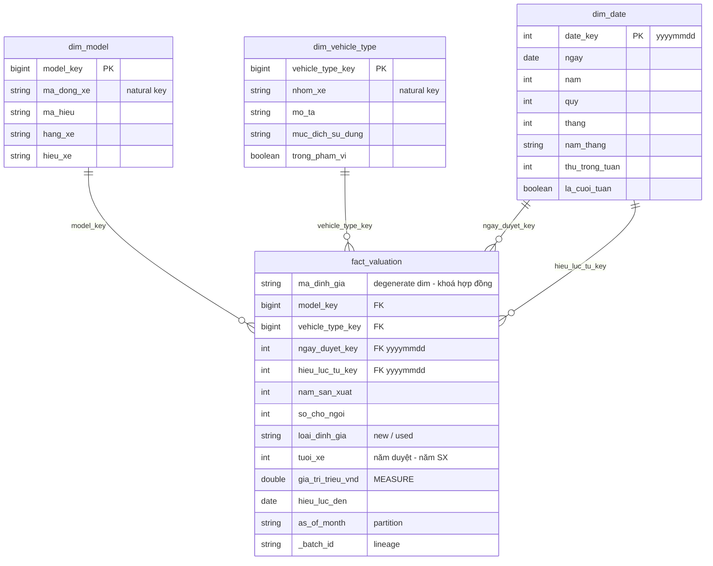

# Giá trị xe ô tô: Data Lake Medallion + Star Schema bằng PySpark

Đề tài xây dựng một pipeline **ELT** thực hiện batch ingestion **bảng định giá xe của nghiệp vụ bảo
hiểm** (18 batch theo tháng, 52.791 hợp đồng) qua các tầng **Landing → Bronze → Silver → Gold**.
Pipeline được thực thi bằng **PySpark 3.5** trên máy cá nhân và lưu trữ dưới định dạng **Parquet**.

Tầng Silver được mô hình hoá thành **lược đồ hình sao** (star schema) gồm 1 fact table và 3 dimension
table. Tầng Gold gồm các bảng tổng hợp (data mart) trả lời các câu hỏi nghiệp vụ, cùng một bảng đặc
trưng (feature table) phục vụ học máy.

---

## Mục lục

1. [Kiến thức học được](#1-kiến-thức-học-được)
2. [Câu hỏi nghiệp vụ](#2-câu-hỏi-nghiệp-vụ)
3. [Kiến trúc](#3-kiến-trúc)
4. [Mô hình dữ liệu](#4-mô-hình-dữ-liệu)
5. [Kiểm soát chất lượng dữ liệu](#5-kiểm-soát-chất-lượng-dữ-liệu)
6. [Cấu trúc thư mục](#6-cấu-trúc-thư-mục)
7. [Cài đặt](#7-cài-đặt)
8. [Chạy pipeline](#8-chạy-pipeline)
9. [Notebook minh hoạ](#9-notebook-minh-hoạ)
10. [Kết quả trên 18 batch thực tế](#10-kết-quả-trên-18-batch-thực-tế)
11. [Kiểm thử](#11-kiểm-thử)
12. [Cơ sở của các quyết định thiết kế](#12-cơ-sở-của-các-quyết-định-thiết-kế)
13. [Xử lý sự cố](#13-xử-lý-sự-cố)
14. [Tài liệu chi tiết](#14-tài-liệu-chi-tiết)

---

## 1. Kiến thức học được

| Khái niệm | Vị trí minh hoạ |
|---|---|
| Kiến trúc Medallion (Landing → Bronze → Silver → Gold) | `src/bronze.py`, `src/silver.py`, `src/gold.py` |
| Batch-level validation trước khi ingest (manifest, checksum, schema) | `src/validate.py` |
| Bronze **append-only**, ingest **idempotent** nhờ sổ batch (batch log) | `src/bronze.py`, `data/control/loaded_batches.csv` |
| Chọn **batch active** khi bên cung cấp gửi lại batch | `silver.active_bronze` |
| **Star schema** theo phương pháp Kimball: fact, dimension, grain, degenerate dimension, role-playing date | `src/silver.py`, [mục 4](#4-mô-hình-dữ-liệu) |
| **Khoá thay thế tất định** (deterministic surrogate key — băm khoá tự nhiên) | `silver.surrogate_key` |
| **Quarantine**: không để mất record nào, mỗi record lỗi mang đúng một `rule_id` | `silver.RULES`, `silver.assign_rule_id` |
| Đối soát (reconciliation) `fact + quarantine = Bronze active` | `silver.run` |
| Truy vấn star schema bằng **Spark SQL** (JOIN + GROUP BY) | `src/gold.py` |
| **Output data contract** được kiểm tra bằng code | `gold.check_ml_contract` |
| Chia train/test theo thời gian, tránh **rò rỉ dữ liệu** (data leakage) | `gold.mart_ml_training_sql` |

---

## 2. Câu hỏi nghiệp vụ

Mỗi câu hỏi tương ứng với một bảng tại tầng Gold.

| # | Câu hỏi | Người sử dụng | Bảng Gold |
|---|---|---|---|
| Q1 | Một dòng xe, đời X, N chỗ được định giá bao nhiêu khi **mới** và khi **đã qua sử dụng**? Tỷ lệ giá trị còn lại là bao nhiêu? | Phân tích | `mart_vehicle_price` |
| Q2 | Số hợp đồng và giá biến động **theo tháng** như thế nào, xét theo hãng và mục đích sử dụng? | Phân tích | `mart_monthly_trend` |
| Q3 | Mỗi batch tháng có **bao nhiêu record bị loại**, và do vi phạm rule nào? | Vận hành | `mart_data_quality` |
| Q4 | Có bảng dữ liệu sạch, đúng grain, đã chia sẵn train/test để **huấn luyện mô hình dự đoán giá** hay không? | Khoa học dữ liệu | `mart_ml_training` |

---

## 3. Kiến trúc

```
  ┌───────────────────────────────┐
  │ LANDING (immutable)           │   CSV theo tháng + _manifest.json
  │ + reference/ref_*.csv         │   (bước Extract vào landing: ngoài phạm vi)
  └───────────────────────────────┘
                 │  Batch-level validation: 5 rule, vi phạm → REJECT toàn bộ batch
                 ▼
  ┌───────────────────────────────┐
  │ BRONZE (append-only)          │   mọi cột kiểu string + _batch_id, _source_file, _ingest_ts
  │ business_valuation            │   ghi dữ liệu TRƯỚC, ghi sổ batch loaded_batches SAU
  └───────────────────────────────┘
                 │  batch active → cast kiểu → LEFT JOIN dimension → 8 rule
                 ▼
  ┌───────────────────────────────┐        ┌──────────────────────────┐
  │ SILVER: STAR SCHEMA           │        │ quarantine               │
  │ fact_valuation                │  ───▶  │ raw record + rule_id     │
  │ dim_model · dim_vehicle_type  │        └──────────────────────────┘
  │ dim_date                      │
  └───────────────────────────────┘
                 │  Spark SQL: JOIN (+ GROUP BY)
                 ▼
  ┌───────────────────────────────┐
  │ GOLD                          │   3 data mart phân tích + 1 bảng ML
  │ mart_vehicle_price            │   (bảng ML được kiểm tra contract trước khi ghi)
  │ mart_monthly_trend            │
  │ mart_data_quality             │
  │ mart_ml_training              │
  └───────────────────────────────┘
```

| Tầng | Vai trò | Chế độ ghi (write mode) |
|---|---|---|
| **Landing** | Vùng tiếp nhận (landing zone) chứa tệp bàn giao nguyên trạng. Không sửa, không xoá | Chỉ đọc (read-only) |
| **Bronze** | Bản sao dữ liệu thô, lưu giữ **mọi** lần bàn giao (kể cả các lần gửi lại) | **Append**, theo batch |
| **Silver** | Làm sạch, chuyển đổi kiểu (cast), quy đổi đơn vị sang triệu VND, lookup dimension, tách quarantine | **Overwrite** (full refresh) |
| **Gold** | Tổng hợp dữ liệu theo câu hỏi nghiệp vụ. **Không làm sạch thêm** | **Overwrite** (full refresh); riêng `mart_ml_training` là **bản chụp** theo (phiên bản ref, mốc chia) |

---

## 4. Mô hình dữ liệu

### Bronze

| Bảng | Grain | Ghi chú |
|---|---|---|
| `business_valuation` | 1 record CSV của 1 lần bàn giao | 16 cột kiểu string + technical column, partition theo `as_of_month` |

### Silver: star schema



| Bảng | Grain (1 record = ?) | Ghi chú |
|---|---|---|
| `fact_valuation` | 1 hợp đồng định giá (`ma_dinh_gia`) | Measure `gia_tri_trieu_vnd`; `ma_dinh_gia` là degenerate dimension |
| `dim_model` | 1 mã dòng xe (`ma_dong_xe`) | Phân cấp (hierarchy) hãng → dòng xe → mã hiệu → mã dòng xe |
| `dim_vehicle_type` | 1 mã loại xe (`nhom_xe`) | Có `muc_dich_su_dung` và cờ (flag) `trong_pham_vi` |
| `dim_date` | 1 ngày | `date_key = yyyymmdd`; đóng hai vai trò (role-playing): ngày duyệt và ngày hiệu lực |
| `quarantine` | 1 record Bronze bị loại | Giữ **nguyên các cột thô** (raw column) + `rule_id` |

Một số quyết định mô hình hoá:

| Quyết định | Cơ sở |
|---|---|
| Surrogate key = `xxhash64(natural key)` | Tính tất định (deterministic): khi re-run hoặc bổ sung mã mới, khoá cũ không thay đổi |
| `nam_san_xuat`, `so_cho_ngoi`, `loai_dinh_gia` đặt trực tiếp trong fact | Không có thuộc tính mô tả đi kèm; tách thành dimension riêng chỉ làm tăng số phép join |
| Mã xe không giải mã được → quarantine, không dùng record "Unknown" | Fact chỉ chứa các record trả lời được câu hỏi về hãng/dòng xe. Khi bổ sung reference data và re-run, record tự động được đưa về fact |
| Không áp dụng SCD (dimension được ghi đè) | Bảng tham chiếu gần như tĩnh; ưu tiên tính đơn giản. Kết quả cũ vẫn tái tạo được nhờ **phiên bản ref** tại landing ([mục 5.4](#54-phiên-bản-reference-data-và-bản-chụp-mart_ml_training)) |
| Quy đổi đơn vị VND → triệu VND tại Silver | Bảo đảm một đơn vị đo lường thống nhất từ tầng Silver trở đi |

### Gold

| Bảng | Grain |
|---|---|
| `mart_vehicle_price` | (hãng, dòng xe, năm sản xuất, số chỗ) |
| `mart_monthly_trend` | (tháng duyệt, hãng, mục đích sử dụng, mới/cũ) |
| `mart_data_quality` | Tháng (`as_of_month`) |
| `mart_ml_training` | 1 hợp đồng, cùng grain với fact, **không** GROUP BY. Lưu tại `ref_version=…/train_end_month=…/` |

### Control và reference data

| Tệp | Vai trò |
|---|---|
| `data/control/loaded_batches.csv` | Sổ batch (batch log) ghi nhận các batch đã ingest, ngăn ingest trùng lặp |
| `data/control/run_log.csv` | Sổ các lần chạy (append-only): phiên bản ref + sha256, mốc chia, số dòng fact/quarantine/train/test |
| `data/landing/reference/ref_model_map/version=YYYY-MM/` | Mã dòng xe → hãng, dòng xe (nguồn của `dim_model`). Mỗi phiên bản + `_manifest.json` |
| `data/landing/reference/ref_veh_type_scope/version=YYYY-MM/` | Mã loại xe → mô tả, có thuộc phạm vi hay không (nguồn của `dim_vehicle_type`) |

---

## 5. Kiểm soát chất lượng dữ liệu

Chất lượng dữ liệu được kiểm soát tại 3 điểm kiểm tra (checkpoint).

### 5.1 Batch-level validation (trước Bronze): vi phạm thì reject toàn bộ batch

| Rule | Lỗi phát hiện |
|---|---|
| `MANIFEST_INVALID` | Thiếu hoặc không đọc được `_manifest.json`, thiếu field bắt buộc |
| `CHECKSUM_MISMATCH` | Giá trị SHA-256 của tệp khác với manifest: tệp bị hỏng, truyền tải không đầy đủ, hoặc bị chỉnh sửa thủ công |
| `SCHEMA_COLUMN_MISSING` | Header thiếu cột so với contract 16 cột |
| `COUNT_MISMATCH` | Số record khác với `record_count` trong manifest |
| `PARTITION_MISMATCH` | Tên thư mục, manifest và cột `as_of_month` không nhất quán |

Một batch bị reject không ngăn cản việc ingest các batch khác.

### 5.2 Record-level validation tại Silver: record lỗi được đưa vào quarantine

Mỗi record lỗi chỉ mang **một** `rule_id`: rule đầu tiên mà record vi phạm, theo thứ tự dưới đây.

| # | `rule_id` | Điều kiện vi phạm |
|---|---|---|
| 1 | `CORRUPT_RECORD` | Record bị vỡ cột |
| 2 | `DUP_KEY` | `ma_dinh_gia` rỗng hoặc trùng lặp (giữ record có ngày hiệu lực muộn nhất) |
| 3 | `MISSING_FIELD` | Rỗng tại `ma_dong_xe` / `nam_san_xuat` / `so_cho_ngoi` |
| 4 | `DATE_INVALID` | Ngày sai định dạng, ngày hết hiệu lực < ngày bắt đầu hiệu lực, hoặc ngày hiệu lực lệch ngày duyệt > 366 ngày |
| 5 | `OUT_OF_SCOPE` | Loại xe không tồn tại trong dimension hoặc nằm ngoài phạm vi ô tô chở người |
| 6 | `MODEL_CODE_UNKNOWN` | Mã dòng xe không tồn tại trong `ref_model_map` |
| 7 | `VALUE_INVALID` | Năm sản xuất, số chỗ hoặc `loai_dinh_gia` nằm ngoài miền giá trị (domain) hợp lệ |
| 8 | `PRICE_INVALID` | Giá sai định dạng hoặc nằm ngoài [50 triệu, 50 tỷ] VND |

Sau bước phân tách, tầng Silver **tự động đối soát** (reconciliation) `fact + quarantine = Bronze
active`. Nếu đẳng thức không thoả mãn, job dừng trước khi ghi kết quả.

Record bị loại do mã xe không xác định có thể được **khôi phục** (recovery): bàn giao **phiên bản
mới** của `ref_model_map` có bổ sung mã rồi re-run. Không cần sửa code, cũng không cần bên cung cấp gửi
lại batch (xem [mục 5.4](#54-phiên-bản-reference-data-và-bản-chụp-mart_ml_training)).

Điều kiện chi tiết của từng rule: [docs/DATA_CONTRACT.md](docs/DATA_CONTRACT.md) §6 và §7.

### 5.3 Output contract của `mart_ml_training`

Trước khi ghi Gold, `gold.check_ml_contract` kiểm tra 4 điều kiện: đúng 11 cột dưới đây, đúng thứ
tự, đúng kiểu dữ liệu, và không cột nào chứa giá trị null. Chỉ cần vi phạm một điều kiện, job dừng
lại và bảng cũ được giữ nguyên.

| # | Cột | Kiểu | Vai trò | Nguồn |
|---|---|---|---|---|
| 1 | `ma_dinh_gia` | string | Định danh (id) phục vụ truy vết, **không đưa vào mô hình** | fact |
| 2 | `hang_xe` | string | Feature | `dim_model` |
| 3 | `hieu_xe` | string | Feature | `dim_model` |
| 4 | `nam_san_xuat` | int | Feature | fact |
| 5 | `tuoi_xe` | int | Feature: năm duyệt − năm sản xuất | fact |
| 6 | `so_cho_ngoi` | int | Feature | fact |
| 7 | `muc_dich_su_dung` | string | Feature | `dim_vehicle_type` |
| 8 | `loai_dinh_gia` | string | Feature: `new` / `used` (thuộc tính suy diễn) | fact |
| 9 | `thang_duyet` | string `YYYY-MM` | Feature thời gian | `dim_date` |
| 10 | `gia_tri_trieu_vnd` | double | **Biến mục tiêu** (target), đơn vị triệu VND | fact |
| 11 | `split` | string | `train` nếu `thang_duyet ≤` mốc chia (mặc định `2026-03`, đổi bằng `--train-end-month`), ngược lại `test` | So sánh `thang_duyet` với mốc chia |

Bảng không chứa feature tổng hợp (aggregate feature, ví dụ giá trung vị theo dòng xe), vì khi được
tính trên toàn bộ dữ liệu, các feature này sẽ làm rò rỉ thông tin giá của tập test vào tập train.
Việc huấn luyện mô hình nằm ngoài phạm vi đề tài.

### 5.4 Phiên bản reference data và bản chụp `mart_ml_training`

Silver ghi đè mỗi lần chạy, nên khi `ref_model_map` đổi, fact và bảng ML của **mọi tháng cũ** được
dựng lại theo ref mới. Để vẫn biết kết quả nào tính với ref nào:

| Thành phần | Cách làm |
|---|---|
| **Phiên bản ref ở landing** | Mỗi bản là thư mục bất biến `version=YYYY-MM/` + manifest (sha256, số dòng, ghi chú thay đổi). Sửa ref = bàn giao phiên bản mới, không ghi đè. Không lưu ở Silver: `dim_model` dựng lại được từ ref |
| **Chọn phiên bản** | Mặc định bản mới nhất cho mọi tháng (restate). `--ref-version 2026-06` → bản mới nhất có version ≤ 2026-06, để tái tạo kết quả cũ. Ref lệch manifest → job dừng |
| **Dấu vết** | `silver/_run_info.json` (Silver dựng từ ref nào, batch nào) và `data/control/run_log.csv` (mỗi lần chạy một dòng, không ghi đè) |
| **Bản chụp ML** | `gold/mart_ml_training/ref_version=…/train_end_month=…/` + `_run_info.json`. Khác (ref, mốc chia) → giữ song song |

Không làm "mỗi tháng dùng ref của tháng đó" (point-in-time) — đó là SCD2, nằm ngoài phạm vi. Chi tiết
và số đo: [docs/ARCHITECTURE.md](docs/ARCHITECTURE.md) §4.2.

---

## 6. Cấu trúc thư mục

```
gia_tri_xe_oto/
├── data/
│   ├── landing/                    # IMMUTABLE, được quản lý trong git
│   │   ├── business_vehicle_valuation/as_of_month=YYYY-MM/{*.csv, _manifest.json}
│   │   └── reference/<ref_name>/version=YYYY-MM/{<ref_name>.csv, _manifest.json}
│   ├── bronze/  silver/  gold/     # sinh ra khi chạy (git-ignore)
│   └── control/{loaded_batches.csv, run_log.csv}  # sổ batch + sổ lần chạy (git-ignore)
├── src/
│   ├── config.py                   # đường dẫn + hằng số dùng chung
│   ├── spark.py                    # khởi tạo SparkSession
│   ├── validate.py                 # batch-level validation (Python thuần, không cần Spark)
│   ├── reference.py                # chọn + kiểm phiên bản reference data
│   ├── bronze.py                   # Landing → Bronze
│   ├── silver.py                   # Bronze → Silver (star schema + quarantine)
│   ├── gold.py                     # Silver → Gold (Spark SQL + contract)
│   ├── run_pipeline.py             # điều phối (orchestrate) cả 3 tầng
│   └── report.py                   # số liệu + biểu đồ cho báo cáo → report/
├── notebook/                       # 4 notebook minh hoạ từng tầng (ghi vào _sandbox/)
├── tests/                          # 28 test pytest
├── docs/DATA_CONTRACT.md           # data contract của tệp bàn giao: 16 cột, manifest, rule kiểm tra
├── output/                         # bản CSV của 4 bảng Gold, mở được bằng Excel
└── requirements.txt
```

---

## 7. Cài đặt

**Yêu cầu hệ thống**
- Python 3.11
- Java 17, biến môi trường `JAVA_HOME` trỏ tới JDK
- Trên Windows: bổ sung `HADOOP_HOME` (xem bên dưới)

```bash
pip install -r requirements.txt      # pyspark 3.5, pandas, pytest, matplotlib
```

<details>
<summary><strong>Thiết lập trên Windows</strong></summary>

Spark trên Windows cần `winutils.exe` và `hadoop.dll`:

1. Tải `winutils.exe` và `hadoop.dll` phiên bản Hadoop 3.x, đặt vào thư mục, ví dụ `C:\hadoop\bin\`.
2. Đặt biến môi trường `HADOOP_HOME=C:\hadoop` và thêm `%HADOOP_HOME%\bin` vào `PATH`.
3. Kiểm tra:

```powershell
java -version            # phải là 17
echo $env:JAVA_HOME
echo $env:HADOOP_HOME
```

</details>

---

## 8. Chạy pipeline

Luôn **thực thi từ thư mục gốc của dự án** và chạy dưới dạng module `python -m src.xxx`.

### Cách A: một lệnh duy nhất

```bash
python -m src.run_pipeline                            # Landing → Bronze → Silver → Gold, khoảng 1 phút
python -m src.run_pipeline --ref-version 2026-06      # tái tạo kết quả với ref ≤ 2026-06
python -m src.run_pipeline --train-end-month 2026-05  # bản chụp ML với mốc chia khác
```

Mã thoát (exit code) 0 nghĩa là thành công. Exit code 1 nghĩa là có batch bị reject, song Silver và
Gold vẫn được thực thi với các batch đã ingest. Mỗi lần chạy thành công thêm một dòng vào
`data/control/run_log.csv`.

### Số liệu và biểu đồ cho báo cáo

```bash
python -m src.report            # → report/SO_LIEU.md + report/figures/hinh_05..09.png, khoảng 2 phút
```

Chạy sau `run_pipeline`. Script dựng lại Silver/Gold trong bộ nhớ cho từng phiên bản ref và kiểm khớp
với Silver trên đĩa, nên số trong báo cáo luôn khớp code. Hai phạm vi số liệu: **(A)** toàn bộ lô với ref
mới nhất (số kỹ thuật) và **(B)** chỉ các lô có thông tin xe thật với ref đầu tiên (kết luận về giá xe).

### Cách B: từng tầng

```bash
python -m src.validate          # chỉ kiểm tra batch tại landing, không cần Spark
python -m src.bronze
python -m src.silver
python -m src.gold
```

### Kiểm tra kết quả

- Log in ra số record của mỗi bảng. Đối chiếu với [mục 10](#10-kết-quả-trên-18-batch-thực-tế).
- Có thể xem nhanh các bảng Gold bằng Excel trong `output/*.csv`. Tệp `output/mart_ml_training.csv`
  (khoảng 3,7 MB, 1 record/hợp đồng) có sẵn trong repo để sử dụng ngay mà không cần chạy pipeline.

### Re-run và khởi tạo lại từ đầu

- Pipeline có thể re-run nhiều lần: Bronze chỉ ingest batch mới, Silver và Gold được tính lại toàn bộ.
- Để khởi tạo lại từ đầu, xoá các thư mục `data/bronze`, `data/silver`, `data/gold`, `data/control`.

---

## 9. Notebook minh hoạ

Mỗi notebook trình bày một tầng theo từng bước nhỏ, kèm các ô kiểm tra (`assert`). Mọi dữ liệu do
notebook ghi ra đều nằm trong `notebook/_sandbox/`, **không** tác động đến `data/` thật. Chạy theo thứ
tự, mỗi notebook dùng Run All.

| Notebook | Nội dung |
|---|---|
| `01_landing_gate1` | 5 rule của batch-level validation; cố ý làm hỏng bản sao của một batch theo từng kiểu để kiểm chứng mỗi rule phát hiện đúng lỗi |
| `02_gate1_bronze` | Ingest vào Bronze, đối chiếu manifest, tính idempotent, batch lỗi không chặn batch khác, gửi lại batch |
| `03_bronze_silver` | Batch active, xây dựng dimension, kiểm tra từng rule trên record dựng thủ công, đối soát, khôi phục record quarantine |
| `04_silver_gold` | 4 data mart bằng Spark SQL, contract của bảng ML, 4 kiểu sai lệch bị chặn, ghi Gold idempotent |

---

## 10. Kết quả trên 18 batch thực tế

| Tầng | Bảng | Số record |
|---|---|---|
| Bronze | `business_valuation` | 52.791 |
| Silver | `fact_valuation` | 44.748 |
| | `quarantine` | 8.043 (15,24%) |
| | `dim_model` · `dim_vehicle_type` · `dim_date` | 1.426 · 42 · 1.461 |
| Gold | `mart_vehicle_price` · `mart_monthly_trend` · `mart_data_quality` | 951 · 876 · 18 |
| | `mart_ml_training` | 44.748 (train 36.525 · test 8.223, mốc chia 2026-03) |

Phân bố quarantine theo rule:

| `MODEL_CODE_UNKNOWN` | `PRICE_INVALID` | `VALUE_INVALID` | `DATE_INVALID` | `MISSING_FIELD` | Khác |
|---|---|---|---|---|---|
| 5.154 | 2.350 | 280 | 225 | 34 | 0 |

## 11. Kiểm thử

```bash
python -m pytest -q             # 19 test, khoảng 1 phút
```

| Tệp | Số test | Nội dung kiểm tra |
|---|---|---|
| `test_validate.py` | 7 | Batch hợp lệ vượt qua validation; mỗi rule phát hiện đúng một kiểu lỗi. Python thuần, không cần Spark |
| `test_pipeline.py` | 7 | Mỗi rule Silver phát hiện đúng record của nó, giữ đúng record khi trùng lặp, không mất record, khoá tất định, Bronze idempotent, khi batch được gửi lại thì Silver đọc bản mới nhất |
| `test_gold.py` | 5 | Bảng ML đúng 1 record/hợp đồng, chia theo tháng, feature lấy từ dimension, khớp contract, contract chặn được bảng sai lệch |

Test chỉ làm hỏng **bản sao** trong thư mục tạm. Tệp trong `data/landing/` không bao giờ bị sửa đổi.

---

## 12. Cơ sở của các quyết định thiết kế

1. **Bronze append, Silver/Gold overwrite.** Bronze đóng vai trò nhật ký bàn giao (audit trail): nếu
   ghi đè, hệ thống mất khả năng trả lời câu hỏi "tháng 6 đã được gửi bao nhiêu lần". Silver/Gold là
   kết quả có thể tính lại, nên full refresh là đủ.
2. **Ghi Bronze trước, ghi sổ batch sau.** Nếu job lỗi giữa chừng, trường hợp xấu nhất là xuất hiện
   bản trùng, và Silver đã xử lý được tình huống này vì chỉ đọc batch active. Nếu làm ngược lại, một
   batch có thể bị mất mà không được phát hiện.
3. **Star schema đặt tại Silver**, ở grain chi tiết nhất. Đây là nền tảng dùng chung: bổ sung câu hỏi
   mới chỉ cần viết thêm một truy vấn SQL tại Gold, không phải làm sạch lại dữ liệu.
4. **LEFT JOIN rồi đưa record không khớp vào quarantine.** INNER JOIN sẽ khiến record biến mất mà
   không để lại dấu vết.
5. **Surrogate key = băm natural key.** Khi bổ sung mã mới hoặc re-run, khoá cũ không thay đổi. Nếu
   dùng `row_number()`, toàn bộ dãy khoá sẽ bị đánh số lại và fact cũ tham chiếu sai.
6. **Không dùng ngày hệ thống trong bước transform.** Mọi mốc thời gian đều được suy ra từ dữ liệu,
   nhờ đó re-run một batch cũ vào năm sau vẫn cho kết quả như cũ (reproducibility).
7. **Dùng trung vị (median) thay vì trung bình (mean).** Một hợp đồng khai giá bất thường (outlier)
   không làm sai lệch giá trị của cả nhóm.
8. **Bảng ML chia theo tháng, không có aggregate feature.** Chia ngẫu nhiên hoặc dùng "giá trung vị
   của dòng xe" tính trên toàn bộ dữ liệu đều làm rò rỉ thông tin của tập test vào tập train
   (data leakage).

---

## 13. Xử lý sự cố

| Triệu chứng | Nguyên nhân thường gặp | Cách khắc phục |
|---|---|---|
| `No module named 'src'` | Chạy `python src/xxx.py` hoặc thực thi sai thư mục | Thực thi từ thư mục gốc, chạy `python -m src.xxx` |
| `Java gateway process exited` | Chưa cài Java 17 hoặc thiếu `JAVA_HOME` | Cài JDK 17, đặt `JAVA_HOME` |
| Lỗi `winutils` / `HADOOP_HOME` trên Windows | Thiếu `winutils.exe` hoặc `hadoop.dll` | Xem [mục 7](#7-cài-đặt) |
| `Chưa có Bronze ...` / `Chưa có ... silver` | Chạy tầng sau trước tầng trước | Chạy `python -m src.run_pipeline`, hoặc chạy lần lượt từng tầng |
| Log báo `REJECT as_of_month=...` | Batch vi phạm batch-level validation | Xem `rule_id` in ngay dưới dòng `REJECT`; batch đó cần được bên cung cấp gửi lại |
| `Đối soát lệch: fact + quarantine ≠ bronze` | Lỗi logic tại Silver (có record bị mất) | Không ghi đè dữ liệu; chạy `pytest` để xác định rule gây lỗi |
| `mart_ml_training sai schema` / `có null` | Sửa SQL tại Gold nhưng chưa cập nhật contract | Cập nhật đồng thời `gold.ML_TRAINING_CONTRACT` và bảng contract tại [mục 5.3](#53-output-contract-của-mart_ml_training) |

---

## 14. Tài liệu chi tiết

| Tệp | Nội dung |
|---|---|
| [docs/DATA_CONTRACT.md](docs/DATA_CONTRACT.md) | Data contract của tệp bàn giao: 16 cột, manifest, 5 rule batch-level, 8 rule record-level, hạn chế đã biết |
| `notebook/01` → `04` | Trình bày từng tầng theo từng bước nhỏ, kèm ô kiểm tra ([mục 9](#9-notebook-minh-hoạ)) |
