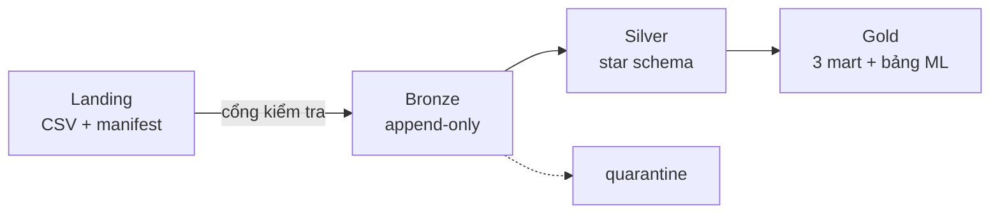

# Giá trị xe ô tô — Data Lake Medallion + Star Schema bằng PySpark

Pipeline nạp **bảng định giá xe của nghiệp vụ bảo hiểm** (18 lô tháng, 52.791 hợp đồng) qua
Landing → Bronze → Silver → Gold. Silver được mô hình hoá thành **star schema**, Gold là các mart
tổng hợp.

Đây là bản **thu gọn** của đề tài `../Pipeline nạp dữ liệu giá xe ô tô bằng PySpark/`: chỉ giữ nguồn
nghiệp vụ, bỏ crawl và phần hợp nhất 2 nguồn. Mục tiêu là **hiểu và nắm kiến thức**. Những gì đã
cắt và lý do: [docs/ARCHITECTURE.md §6](docs/ARCHITECTURE.md#6-những-gì-đã-cắt-so-với-đề-tài-cũ).



## Chạy

Cần Python 3.11, Java 17 (`JAVA_HOME`). Trên Windows thêm `HADOOP_HOME` có `bin/winutils.exe` và
`bin/hadoop.dll`.

```bash
pip install -r requirements.txt

python -m src.run_pipeline      # cả pipeline (~1 phút)
python -m src.validate          # chỉ kiểm tra lô ở landing, không cần Spark
python -m src.bronze            # từng tầng riêng lẻ
python -m src.silver
python -m src.gold
python -m pytest -q             # 19 test (~1 phút)
```

Luôn đứng ở thư mục gốc dự án và chạy dạng `python -m src.xxx`. Chạy kiểu `python src/xxx.py` sẽ lỗi
`No module named 'src'`.

Chạy lại bao nhiêu lần cũng được: Bronze chỉ nạp lô mới, Silver/Gold dựng lại toàn bộ. Muốn làm lại
từ đầu thì xoá `data/bronze`, `data/silver`, `data/gold`, `data/control`.

## Kết quả trên 18 lô thật

| Tầng | Bảng | Dòng |
|---|---|---|
| Bronze | `business_valuation` | 52.791 |
| Silver | `fact_valuation` | 44.748 |
| | `quarantine` | 8.043 (15,24%) — 5.154 mã xe chưa giải mã · 2.350 giá không hợp lệ · 280 giá trị ngoài miền · 225 ngày sai · 34 thiếu trường |
| | `dim_model` · `dim_vehicle_type` · `dim_date` | 1.426 · 42 · 1.461 |
| Gold | `mart_vehicle_price` · `mart_monthly_trend` · `mart_data_quality` | 951 · 876 · 18 |
| | `mart_ml_training` — bảng đặc trưng cho ML, 1 dòng / hợp đồng | 44.748 (train 36.525 · test 8.223) |

Bản CSV của Gold nằm ở `output/`, mở được bằng Excel (`mart_ml_training.csv` không đưa vào git).

## Tài liệu

| File | Nội dung |
|---|---|
| [docs/ARCHITECTURE.md](docs/ARCHITECTURE.md) | Luồng dữ liệu, star schema (ERD), grain, luật quarantine, các quyết định thiết kế |
| [docs/DATA_CONTRACT.md](docs/DATA_CONTRACT.md) | File bàn giao: 16 cột, manifest, 5 luật cổng kiểm tra |
| [docs/KIEN_THUC.md](docs/KIEN_THUC.md) | Khái niệm → chỗ nằm trong code · 13 câu hỏi tự kiểm tra · bài tập mở rộng |
