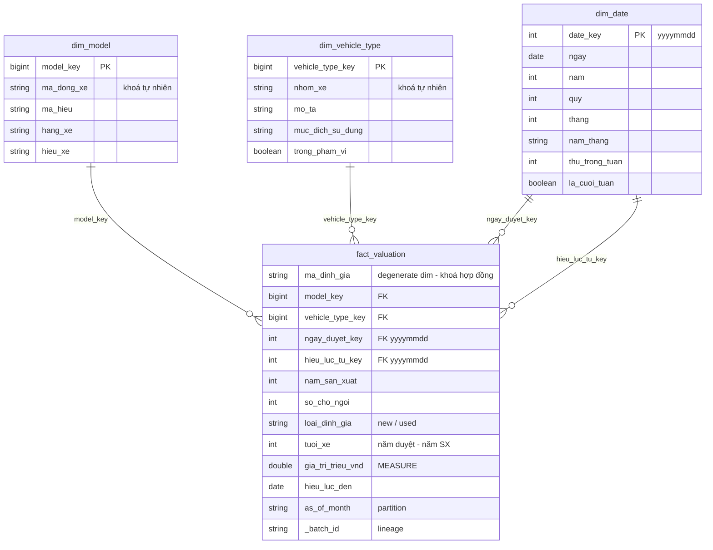

# Giá trị xe ô tô: Data Lake Medallion + Star Schema bằng PySpark

Pipeline **ELT** nạp **bảng định giá xe của nghiệp vụ bảo hiểm** (18 lô tháng, 52.791 hợp đồng)
qua các tầng **Landing → Bronze → Silver → Gold**, chạy bằng **PySpark 3.5** trên máy cá nhân và lưu
**Parquet**.

Silver được mô hình hoá thành **star schema** (1 fact + 3 dimension). Gold là các bảng tổng hợp
trả lời câu hỏi nghiệp vụ, cộng một bảng đặc trưng cho ML.

---

## Mục lục

1. [Đề tài dạy gì](#1-đề-tài-dạy-gì)
2. [Câu hỏi nghiệp vụ](#2-câu-hỏi-nghiệp-vụ)
3. [Kiến trúc](#3-kiến-trúc)
4. [Mô hình dữ liệu](#4-mô-hình-dữ-liệu)
5. [Kiểm soát chất lượng](#5-kiểm-soát-chất-lượng)
6. [Cấu trúc thư mục](#6-cấu-trúc-thư-mục)
7. [Cài đặt](#7-cài-đặt)
8. [Chạy pipeline](#8-chạy-pipeline)
9. [Notebook minh hoạ](#9-notebook-minh-hoạ)
10. [Kết quả trên 18 lô thật](#10-kết-quả-trên-18-lô-thật)
11. [Kiểm thử](#11-kiểm-thử)
12. [Vì sao thiết kế như vậy](#12-vì-sao-thiết-kế-như-vậy)
13. [Xử lý sự cố](#13-xử-lý-sự-cố)
14. [Tài liệu chi tiết](#14-tài-liệu-chi-tiết)

---

## 1. Kiến thức học được

| Khái niệm | Xem ở đâu |
|---|---|
| Kiến trúc Medallion (Landing → Bronze → Silver → Gold) | `src/bronze.py`, `src/silver.py`, `src/gold.py` |
| Cổng kiểm tra lô trước khi nạp (manifest, checksum, schema) | `src/validate.py` |
| Bronze **append-only**, nạp **idempotent** bằng sổ lô | `src/bronze.py`, `data/control/loaded_batches.csv` |
| Chọn **lô active** khi bên cung cấp gửi lại lô | `silver.active_bronze` |
| **Star schema** kiểu Kimball: fact, dimension, grain, degenerate dimension, role-playing date | `src/silver.py`, [mục 4](#4-mô-hình-dữ-liệu) |
| **Khoá thay thế tất định** (băm khoá tự nhiên) | `silver.surrogate_key` |
| **Quarantine**: không bao giờ để mất dòng, mỗi dòng lỗi mang một `rule_id` | `silver.RULES`, `silver.assign_rule_id` |
| Đối soát `fact + quarantine = Bronze active` | `silver.run` |
| Truy vấn star schema bằng **Spark SQL** (JOIN + GROUP BY) | `src/gold.py` |
| **Data contract đầu ra** được kiểm bằng code | `gold.check_ml_contract` |
| Chia train/test theo thời gian, tránh **leakage** | `gold.mart_ml_training_sql` |

---

## 2. Câu hỏi nghiệp vụ

Mỗi câu hỏi ứng với một bảng Gold.

| # | Câu hỏi | Người dùng | Bảng Gold |
|---|---|---|---|
| Q1 | Một dòng xe, đời X, N chỗ được định giá bao nhiêu khi **mới** và khi **đã qua sử dụng**? Còn lại bao nhiêu % giá trị? | Phân tích | `mart_vehicle_price` |
| Q2 | Số hợp đồng và giá biến động **theo tháng** thế nào, theo hãng và mục đích sử dụng? | Phân tích | `mart_monthly_trend` |
| Q3 | Mỗi lô tháng có **bao nhiêu dòng bị loại**, vì luật nào? | Vận hành | `mart_data_quality` |
| Q4 | Có bảng sạch, đúng grain, chia sẵn train/test để **huấn luyện model dự đoán giá** không? | Khoa học dữ liệu | `mart_ml_training` |

---

## 3. Kiến trúc

```
  ┌───────────────────────────────┐
  │ LANDING (bất biến)            │   CSV tháng + _manifest.json
  │ + reference/ref_*.csv         │   (cách trích vào landing: ngoài phạm vi)
  └───────────────────────────────┘
                 │  Cổng kiểm tra: 5 luật, sai là REJECT cả lô
                 ▼
  ┌───────────────────────────────┐
  │ BRONZE (append-only)          │   mọi cột string + _batch_id, _source_file, _ingest_ts
  │ business_valuation            │   ghi dữ liệu TRƯỚC, ghi sổ loaded_batches SAU
  └───────────────────────────────┘
                 │  lô active → parse kiểu → LEFT JOIN dim → 8 luật
                 ▼
  ┌───────────────────────────────┐        ┌──────────────────────────┐
  │ SILVER: STAR SCHEMA           │        │ quarantine               │
  │ fact_valuation                │  ───▶  │ dòng thô + rule_id       │
  │ dim_model · dim_vehicle_type  │        └──────────────────────────┘
  │ dim_date                      │
  └───────────────────────────────┘
                 │  Spark SQL: JOIN (+ GROUP BY)
                 ▼
  ┌───────────────────────────────┐
  │ GOLD                          │   3 mart phân tích + 1 bảng ML
  │ mart_vehicle_price            │   (bảng ML kiểm contract trước khi ghi)
  │ mart_monthly_trend            │
  │ mart_data_quality             │
  │ mart_ml_training              │
  └───────────────────────────────┘
```

| Tầng | Vai trò | Kiểu ghi |
|---|---|---|
| **Landing** | File bàn giao nguyên trạng. Không sửa, không xoá | chỉ đọc |
| **Bronze** | Bản sao thô, giữ **mọi** lần bàn giao (kể cả lần gửi lại) | **append**, theo lô |
| **Silver** | Làm sạch, ép kiểu, đổi đơn vị sang triệu VND, tra dimension, tách quarantine | **overwrite** (full refresh) |
| **Gold** | Tổng hợp theo câu hỏi nghiệp vụ. **Không làm sạch thêm** | **overwrite** (full refresh) |

---

## 4. Mô hình dữ liệu

### Bronze

| Bảng | Grain | Ghi chú |
|---|---|---|
| `business_valuation` | 1 dòng CSV của 1 lần bàn giao | 16 cột string + cột kỹ thuật, partition `as_of_month` |

### Silver: star schema



| Bảng | Grain (1 dòng = ?) | Ghi chú |
|---|---|---|
| `fact_valuation` | 1 hợp đồng định giá (`ma_dinh_gia`) | measure `gia_tri_trieu_vnd`; `ma_dinh_gia` là degenerate dimension |
| `dim_model` | 1 mã dòng xe (`ma_dong_xe`) | phân cấp hãng → dòng xe → mã hiệu → mã dòng xe |
| `dim_vehicle_type` | 1 mã loại xe (`nhom_xe`) | có `muc_dich_su_dung` và cờ `trong_pham_vi` |
| `dim_date` | 1 ngày | `date_key = yyyymmdd`; dùng hai vai: ngày duyệt và ngày hiệu lực |
| `quarantine` | 1 dòng Bronze bị loại | giữ **nguyên cột thô** + `rule_id` |

Một số quyết định mô hình hoá:

| Quyết định | Lý do |
|---|---|
| Khoá thay thế = `xxhash64(khoá tự nhiên)` | Tất định: chạy lại hay thêm mã mới thì khoá cũ không đổi |
| `nam_san_xuat`, `so_cho_ngoi`, `loai_dinh_gia` để thẳng trong fact | Không có thuộc tính mô tả đi kèm; tách thành dimension chỉ thêm join |
| Mã xe không giải mã được → quarantine, không dùng dòng "Unknown" | Fact chỉ chứa dòng trả lời được câu hỏi về hãng/dòng xe. Bổ sung ref rồi chạy lại là dòng tự quay về fact |
| Không SCD (dimension ghi đè) | Bảng tham chiếu gần như tĩnh; giữ đơn giản |
| Đơn vị: VND → triệu VND ở Silver | Một đơn vị duy nhất từ Silver trở đi |

### Gold

| Bảng | Grain |
|---|---|
| `mart_vehicle_price` | (hãng, dòng xe, năm sản xuất, số chỗ) |
| `mart_monthly_trend` | (tháng duyệt, hãng, mục đích sử dụng, mới/cũ) |
| `mart_data_quality` | tháng (`as_of_month`) |
| `mart_ml_training` | 1 hợp đồng, giống fact, **không** GROUP BY |

### Control

| File | Vai trò |
|---|---|
| `data/control/loaded_batches.csv` | Sổ các lô đã nạp, chống nạp trùng |
| `data/landing/reference/ref_model_map.csv` | Mã dòng xe → hãng, dòng xe (nguồn của `dim_model`) |
| `data/landing/reference/ref_veh_type_scope.csv` | Mã loại xe → mô tả, trong phạm vi hay không (nguồn của `dim_vehicle_type`) |

---

## 5. Kiểm soát chất lượng

Dữ liệu được kiểm ở 3 chốt.

### 5.1 Cổng kiểm tra lô (trước Bronze): sai là từ chối cả lô

| Luật | Bắt lỗi gì |
|---|---|
| `MANIFEST_INVALID` | Không có hoặc không đọc được `_manifest.json`, thiếu field bắt buộc |
| `CHECKSUM_MISMATCH` | sha256 của file khác manifest: file hỏng, truyền thiếu, hoặc bị sửa tay |
| `SCHEMA_COLUMN_MISSING` | Header thiếu cột so với contract 16 cột |
| `COUNT_MISMATCH` | Số dòng khác `record_count` trong manifest |
| `PARTITION_MISMATCH` | Tên thư mục, manifest và cột `as_of_month` không trùng nhau |

Một lô bị từ chối không chặn các lô khác.

### 5.2 Luật dòng ở Silver: dòng lỗi vào quarantine

Mỗi dòng lỗi chỉ mang **một** `rule_id`: luật đầu tiên nó vi phạm, theo thứ tự dưới đây.

| # | `rule_id` | Điều kiện vi phạm |
|---|---|---|
| 1 | `CORRUPT_RECORD` | Dòng vỡ cột |
| 2 | `DUP_KEY` | `ma_dinh_gia` rỗng hoặc trùng (giữ dòng hiệu lực muộn nhất) |
| 3 | `MISSING_FIELD` | Rỗng ở `ma_dong_xe` / `nam_san_xuat` / `so_cho_ngoi` |
| 4 | `DATE_INVALID` | Ngày sai dạng, hiệu lực đến < hiệu lực từ, hoặc hiệu lực lệch ngày duyệt > 366 ngày |
| 5 | `OUT_OF_SCOPE` | Loại xe không có trong dim hoặc ngoài phạm vi ô tô con |
| 6 | `MODEL_CODE_UNKNOWN` | Mã dòng xe không có trong `ref_model_map` |
| 7 | `VALUE_INVALID` | Năm sản xuất, số chỗ hoặc `loai_dinh_gia` ngoài miền hợp lệ |
| 8 | `PRICE_INVALID` | Giá sai dạng hoặc ngoài [50 triệu, 50 tỷ] VND |

Sau khi tách, Silver **tự đối soát** `fact + quarantine = Bronze active`. Nếu lệch, job dừng trước
khi ghi.

Dòng bị loại vì mã xe lạ có thể **cứu** được: bổ sung mã vào `ref_model_map.csv` rồi chạy lại
Silver. Không cần sửa code, không cần bên cung cấp gửi lại lô.

Điều kiện chi tiết của từng luật: [docs/DATA_CONTRACT.md](docs/DATA_CONTRACT.md) §6 và §7.

### 5.3 Contract đầu ra của `mart_ml_training` (trước khi ghi Gold)

`gold.check_ml_contract` kiểm 4 điều: đúng 11 cột dưới đây, đúng thứ tự, đúng kiểu, không cột nào
null. Sai một điều là job dừng và bảng cũ được giữ nguyên.

| # | Cột | Kiểu | Vai trò | Nguồn |
|---|---|---|---|---|
| 1 | `ma_dinh_gia` | string | id, để truy vết, **không đưa vào model** | fact |
| 2 | `hang_xe` | string | feature | `dim_model` |
| 3 | `hieu_xe` | string | feature | `dim_model` |
| 4 | `nam_san_xuat` | int | feature | fact |
| 5 | `tuoi_xe` | int | feature: năm duyệt − năm sản xuất | fact |
| 6 | `so_cho_ngoi` | int | feature | fact |
| 7 | `muc_dich_su_dung` | string | feature | `dim_vehicle_type` |
| 8 | `loai_dinh_gia` | string | feature: `new` / `used` (suy luận) | fact |
| 9 | `thang_duyet` | string `YYYY-MM` | feature thời gian | `dim_date` |
| 10 | `gia_tri_trieu_vnd` | double | **target**, triệu VND | fact |
| 11 | `split` | string | `train` nếu `thang_duyet ≤ 2026-03`, ngược lại `test` | `thang_duyet` so với mốc |

Bảng không có feature tổng hợp (ví dụ giá trung vị theo dòng xe), vì tính trên toàn bộ dữ liệu sẽ
làm lộ giá của tập test vào tập train. Huấn luyện model nằm ngoài phạm vi đề tài.

---

## 6. Cấu trúc thư mục

```
gia_tri_xe_oto/
├── data/
│   ├── landing/                    # BẤT BIẾN, có trong git
│   │   ├── business_vehicle_valuation/as_of_month=YYYY-MM/{*.csv, _manifest.json}
│   │   └── reference/{ref_model_map.csv, ref_veh_type_scope.csv}
│   ├── bronze/  silver/  gold/     # sinh ra khi chạy (git-ignore)
│   └── control/loaded_batches.csv  # sổ lô đã nạp (git-ignore)
├── src/
│   ├── config.py                   # đường dẫn + hằng số dùng chung
│   ├── spark.py                    # tạo SparkSession
│   ├── validate.py                 # cổng kiểm tra lô (Python thuần, không cần Spark)
│   ├── bronze.py                   # Landing → Bronze
│   ├── silver.py                   # Bronze → Silver (star schema + quarantine)
│   ├── gold.py                     # Silver → Gold (Spark SQL + contract)
│   └── run_pipeline.py             # chạy cả 3 tầng
├── notebook/                       # 4 notebook minh hoạ từng tầng (ghi vào _sandbox/)
├── tests/                          # 19 test pytest
├── docs/DATA_CONTRACT.md           # contract file bàn giao: 16 cột, manifest, luật kiểm tra
├── output/                         # bản CSV của 4 bảng Gold, mở bằng Excel
└── requirements.txt
```

---

## 7. Cài đặt

**Cần có**
- Python 3.11
- Java 17, biến môi trường `JAVA_HOME` trỏ tới JDK
- Trên Windows: thêm `HADOOP_HOME` (xem bên dưới)

```bash
pip install -r requirements.txt      # pyspark 3.5, pandas, pytest
```

<details>
<summary><strong>Thiết lập trên Windows</strong></summary>

Spark trên Windows cần `winutils.exe` và `hadoop.dll`:

1. Tải `winutils.exe` và `hadoop.dll` bản Hadoop 3.x, đặt vào ví dụ `C:\hadoop\bin\`.
2. Đặt biến môi trường `HADOOP_HOME=C:\hadoop` và thêm `%HADOOP_HOME%\bin` vào `PATH`.
3. Kiểm tra:

```powershell
java -version            # phải là 17
echo $env:JAVA_HOME
echo $env:HADOOP_HOME
```

</details>

---

## 8. Chạy pipeline

Luôn **đứng ở thư mục gốc dự án** và chạy dạng module `python -m src.xxx`.

### Cách A: một lệnh

```bash
python -m src.run_pipeline      # Landing → Bronze → Silver → Gold, khoảng 1 phút
```

Mã thoát 0 là ổn. Mã thoát 1 nghĩa là có lô bị từ chối, nhưng Silver và Gold vẫn chạy với các lô
đã nạp.

### Cách B: từng tầng

```bash
python -m src.validate          # chỉ kiểm tra lô ở landing, không cần Spark
python -m src.bronze
python -m src.silver
python -m src.gold
```

### Kiểm tra kết quả

- Log in số dòng mỗi bảng. So với [mục 10](#10-kết-quả-trên-18-lô-thật).
- Mở nhanh các bảng Gold bằng Excel trong `output/*.csv`. File `output/mart_ml_training.csv`
  (khoảng 3,7 MB, 1 dòng/hợp đồng) có sẵn trong repo để dùng ngay mà không phải chạy pipeline.

### Chạy lại và làm lại từ đầu

- Chạy lại bao nhiêu lần cũng được: Bronze chỉ nạp lô mới, Silver và Gold dựng lại toàn bộ.
- Muốn làm lại từ đầu thì xoá `data/bronze`, `data/silver`, `data/gold`, `data/control`.

---

## 9. Notebook minh hoạ

Mỗi notebook đi qua một tầng theo từng bước nhỏ, kèm ô kiểm tra (`assert`). Mọi thứ notebook ghi ra
nằm trong `notebook/_sandbox/`, **không** đụng `data/` thật. Chạy theo thứ tự, mỗi notebook dùng
Run All.

| Notebook | Nội dung |
|---|---|
| `01_landing_gate1` | 5 luật của cổng kiểm tra; làm hỏng bản sao của một lô theo từng kiểu để thấy mỗi luật bắt đúng lỗi |
| `02_gate1_bronze` | Nạp Bronze, khớp manifest, idempotent, lô hỏng không chặn lô khác, gửi lại lô |
| `03_bronze_silver` | Lô active, dựng dimension, từng luật trên dòng dựng tay, đối soát, cứu dòng quarantine |
| `04_silver_gold` | 4 mart bằng Spark SQL, contract của bảng ML, 4 kiểu lệch bị chặn, ghi Gold idempotent |

---

## 10. Kết quả trên 18 lô thật

| Tầng | Bảng | Số dòng |
|---|---|---|
| Bronze | `business_valuation` | 52.791 |
| Silver | `fact_valuation` | 44.748 |
| | `quarantine` | 8.043 (15,24%) |
| | `dim_model` · `dim_vehicle_type` · `dim_date` | 1.426 · 42 · 1.461 |
| Gold | `mart_vehicle_price` · `mart_monthly_trend` · `mart_data_quality` | 951 · 876 · 18 |
| | `mart_ml_training` | 44.748 (train 36.525 · test 8.223, mốc 2026-03) |

Quarantine chia theo luật:

| `MODEL_CODE_UNKNOWN` | `PRICE_INVALID` | `VALUE_INVALID` | `DATE_INVALID` | `MISSING_FIELD` | Khác |
|---|---|---|---|---|---|
| 5.154 | 2.350 | 280 | 225 | 34 | 0 |

## 11. Kiểm thử

```bash
python -m pytest -q             # 19 test, khoảng 1 phút
```

| File | Số test | Kiểm gì |
|---|---|---|
| `test_validate.py` | 7 | Lô tốt qua cổng; mỗi luật của cổng bắt đúng một kiểu lỗi. Python thuần, không cần Spark |
| `test_pipeline.py` | 7 | Mỗi luật Silver bắt đúng dòng của nó, giữ dòng trùng đúng, không mất dòng, khoá tất định, Bronze idempotent, gửi lại lô thì Silver đọc bản mới nhất |
| `test_gold.py` | 5 | Bảng ML đúng 1 dòng/hợp đồng, chia theo tháng, feature lấy từ dimension, khớp contract, contract chặn được bảng lệch |

Test chỉ làm hỏng **bản sao** trong thư mục tạm. File trong `data/landing/` không bao giờ bị sửa.

---

## 12. Vì sao thiết kế như vậy

1. **Bronze append, Silver/Gold overwrite.** Bronze là nhật ký bàn giao: ghi đè thì mất khả năng
   trả lời "tháng 6 đã gửi mấy lần". Silver/Gold là kết quả tính lại được nên full refresh là đủ.
2. **Ghi Bronze trước, ghi sổ sau.** Nếu hỏng giữa chừng, tệ nhất là có bản trùng, và Silver đã
   xử lý được vì chỉ đọc lô active. Làm ngược lại thì có thể mất cả một lô mà không ai biết.
3. **Star schema đặt ở Silver**, ở grain chi tiết nhất. Đây là nền chung: thêm câu hỏi mới chỉ cần
   viết thêm một câu SQL ở Gold, không phải làm sạch lại.
4. **LEFT JOIN rồi đưa dòng không khớp vào quarantine.** INNER JOIN sẽ làm dòng biến mất không dấu
   vết.
5. **Khoá thay thế = băm khoá tự nhiên.** Thêm mã mới hay chạy lại thì khoá cũ không đổi.
   `row_number()` sẽ đánh số lại cả dãy và fact cũ trỏ sai.
6. **Không dùng ngày hệ thống trong transform.** Mọi mốc thời gian suy từ dữ liệu, nên chạy lại lô
   cũ vào năm sau vẫn ra đúng kết quả cũ.
7. **Trung vị thay vì trung bình.** Một hợp đồng khai giá bất thường không kéo lệch cả nhóm.
8. **Bảng ML chia theo tháng, không có feature tổng hợp.** Chia ngẫu nhiên hoặc dùng "giá trung vị
   của dòng xe" tính trên toàn bộ dữ liệu đều làm lộ thông tin tập test vào tập train (leakage).

---

## 13. Xử lý sự cố

| Triệu chứng | Nguyên nhân thường gặp | Cách sửa |
|---|---|---|
| `No module named 'src'` | Chạy `python src/xxx.py` hoặc đứng sai thư mục | Đứng ở thư mục gốc, chạy `python -m src.xxx` |
| `Java gateway process exited` | Chưa cài Java 17 hoặc thiếu `JAVA_HOME` | Cài JDK 17, đặt `JAVA_HOME` |
| Lỗi `winutils` / `HADOOP_HOME` trên Windows | Thiếu `winutils.exe` hoặc `hadoop.dll` | Xem [mục 7](#7-cài-đặt) |
| `Chưa có Bronze ...` / `Chưa có ... silver` | Chạy tầng sau trước tầng trước | Chạy `python -m src.run_pipeline`, hoặc chạy lần lượt từng tầng |
| Log báo `REJECT as_of_month=...` | Lô vi phạm cổng kiểm tra | Xem `rule_id` in ngay dưới dòng `REJECT`; lô đó cần bên cung cấp gửi lại |
| `Đối soát lệch: fact + quarantine ≠ bronze` | Lỗi logic ở Silver (có dòng bị mất) | Không ghi đè gì; chạy `pytest` để tìm luật gây lỗi |
| `mart_ml_training sai schema` / `có null` | Đổi SQL Gold mà chưa đổi contract | Sửa `gold.ML_TRAINING_CONTRACT` và bảng contract ở [mục 5.3](#53-contract-đầu-ra-của-mart_ml_training-trước-khi-ghi-gold) cùng lúc |

---

## 14. Tài liệu chi tiết

| File | Nội dung |
|---|---|
| [docs/DATA_CONTRACT.md](docs/DATA_CONTRACT.md) | File bàn giao: 16 cột, manifest, 5 luật cổng kiểm tra, 8 luật dòng, hạn chế đã biết |
| `notebook/01` → `04` | Đi qua từng tầng theo từng bước nhỏ, kèm ô kiểm tra ([mục 9](#9-notebook-minh-hoạ)) |
